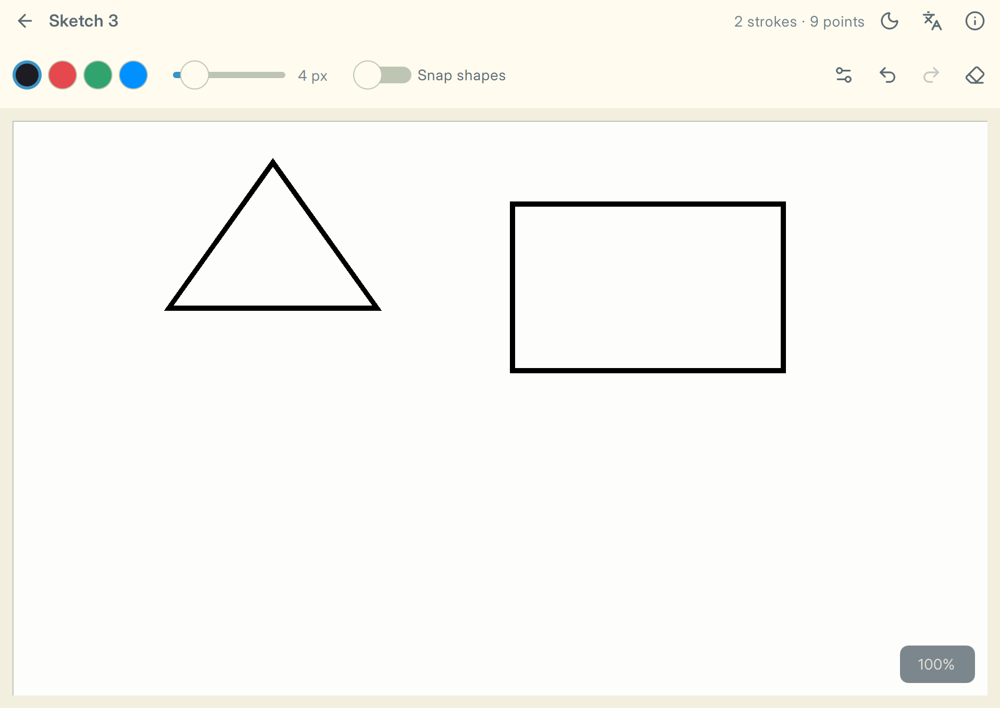

# Qt Kickstart

A guide to the concepts behind cross-platform Qt Quick applications, and a template that
applies every one of them. Qt 6.12, C++23, CMake.

**Read the guide: [deeedob.github.io/qt-kickstart](https://deeedob.github.io/qt-kickstart/)**



The demo app, *Sketchbook*, recognizes the shapes you draw. It is small, but built, tested
and packaged the way a product would be.

## Get started

You need CMake 3.31, Ninja, a C++23 compiler (Xcode 16, Visual Studio 2022 or GCC 14) and
Qt 6.12 from the [Qt Online Installer](https://www.qt.io/download-qt-installer-oss).

```sh
git clone --recurse-submodules https://github.com/deeedob/qt-kickstart.git
cd qt-kickstart
export QT_ROOT_DIR=~/Qt/6.12.0/macos        # Windows: $env:QT_ROOT_DIR="C:\Qt\6.12.0\msvc2022_64"

cmake --workflow --preset dev               # configure, build and test
cmake --build --preset dev --target run     # start the app
```

On Windows, use a *Developer PowerShell for VS 2022*.

## Make it yours

Click *Use this template* on GitHub, clone your repository, then run:

```sh
python3 tools/make_it_yours.py
```

It asks for your app's name, bundle id and copyright holder, and can remove the demo, the
guide, and rename the `App` prefix.

## What the template adds

| | |
|---|---|
| **Workflow presets** | `dev`, `asan` (AddressSanitizer and UBSan), `release` (with a package), `qt-from-source` (Qt built by vcpkg; needs autotools outside Windows): `cmake --workflow --preset <name>` |
| **`check` and `format`** | One target runs clang-format, clangd-tidy, qmllint and REUSE; `format` fixes the files. Tools that are not installed are skipped. |
| **`app_target_defaults()`** | Warnings as errors, Qt's strict mode, hardening and sanitizers for your own targets, and registers their sources for `check` |
| **`app_add_notice()`** | Ships a third-party license in the package; licenses of vcpkg dependencies are added automatically |
| **`app_add_build_info()`** | Version, Git commit and build time, compiled into the app |
| **`run`** | Builds and starts the app: `cmake --build --preset dev --target run` |
| **Packaging** | The `release` workflow deploys Qt and writes a `.dmg`, `.zip` or `.tar.gz` |
| **vcpkg triplets** | Dependencies built once, in release; LGPL libraries linked dynamically |
| **CI** | GitHub Actions builds, tests and packages on Linux, macOS and Windows |
| **`AGENTS.md`** | The project's rules and commands for AI coding agents, read by most of them automatically |

## License

[MIT-0](LICENSE): use it for anything, no attribution required. Bundled third-party files
keep their own licenses, listed in [REUSE.toml](REUSE.toml).
