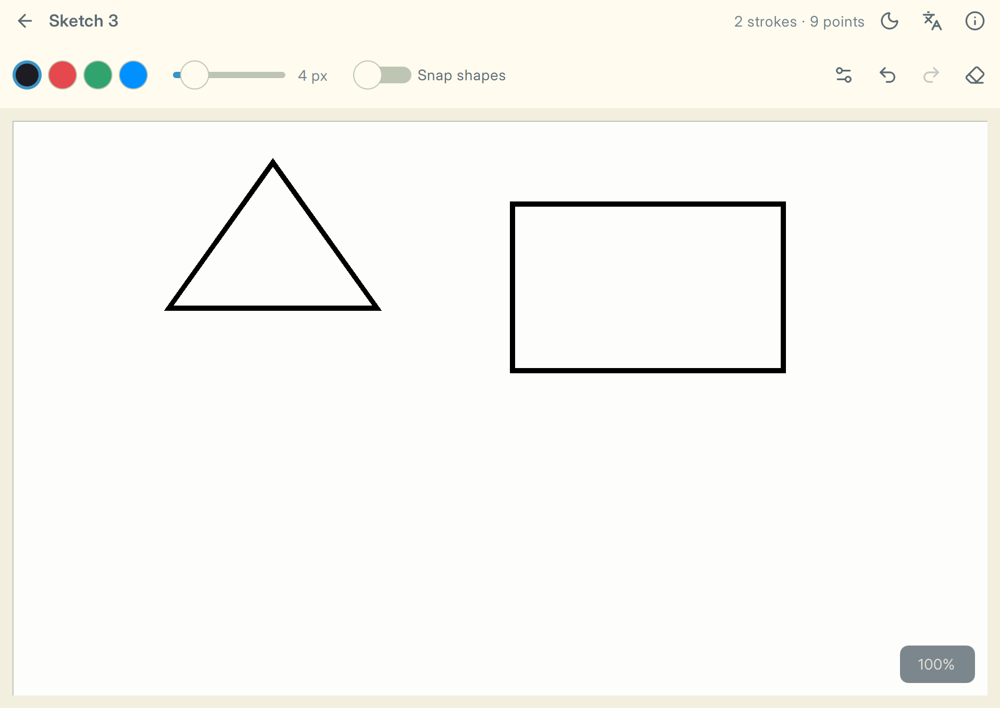
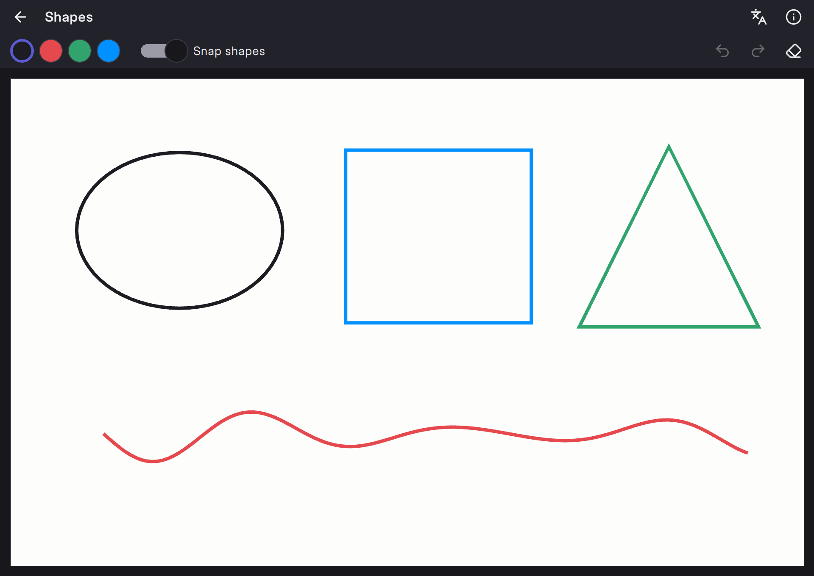

# Look and feel {#sec-look}

An application's look belongs in one place, not scattered over its pages. This chapter
covers a custom control style and design tokens with light and dark themes. Drawing your own
items in C++ is covered in the chapter on connecting C++ and QML (@sec-custom-items).

## Your own Qt Quick Controls style {#sec-style}

Every Qt Quick control comes in two halves. A **template** in `QtQuick.Templates` holds the
behavior: what pressed, checked and focused mean. A **style** draws it. Writing your own style
means drawing the controls you use on top of their templates:

```{.qml filename="controls/Button.qml"}
import QtQuick
import QtQuick.Templates as T

T.Button {
    id: control

    implicitWidth: Math.max(implicitBackgroundWidth,
                            implicitContentWidth + leftPadding + rightPadding)
    implicitHeight: Math.max(implicitBackgroundHeight,
                             implicitContentHeight + topPadding + bottomPadding)
    padding: 8
    horizontalPadding: 16

    contentItem: Text {
        text: control.text
        font: control.font
        color: control.highlighted ? Theme.accentText : Theme.text
        horizontalAlignment: Text.AlignHCenter
        verticalAlignment: Text.AlignVCenter
    }

    background: Rectangle {
        implicitHeight: 36
        radius: Theme.radius
        color: control.highlighted ? Theme.accent
             : control.down ? Theme.pressed : Theme.surface
    }
}
```

Put these files into their own QML module and let it fall back to the Basic style for every
control you do not restyle:

```{.cmake filename="controls/CMakeLists.txt"}
qt_add_qml_module(app_controls
    URI App.Controls
    IMPORTS QtQuick.Controls.Basic
    QML_FILES Button.qml Theme.qml   # and every other control you style
)
```

Views then write `import App.Controls` instead of `import QtQuick.Controls`. Because the style is
chosen at compile time, qmllint and the QML compiler know the exact type of every control.
Basic is the style made for customization; the native macOS and Windows styles are not.

::: {.more}
**Template:** `src/controls/`

**Read more:** [Customizing Qt Quick Controls](https://doc.qt.io/qt-6/qtquickcontrols-customize.html)
:::

## Design tokens and dark mode {#sec-theme}

Colors, spacing, radii and fonts are **design tokens**. Every control reads them from one
place, never from literals. For an app with a light and a dark theme, a QML singleton is
enough:

```{.qml filename="controls/Theme.qml"}
pragma Singleton
import QtQuick

QtObject {
    property bool dark: Application.styleHints.colorScheme ===
                        Qt.ColorScheme.Dark

    readonly property color window: dark ? "#17171c" : "#f6f6f8"
    readonly property color surface: dark ? "#22222a" : "#ffffff"
    readonly property color pressed: dark ? "#393944" : "#dedee6"
    readonly property color text: dark ? "#ececf1" : "#1c1c22"
    readonly property color accent: "#5b5bd6"
    readonly property color accentText: "#ffffff"
    readonly property int radius: 8
}
```

The tokens follow the system's color scheme, so the whole app switches between light and dark
with no code in the views. This is the right default.

Some professional applications also let people choose a light or dark appearance explicitly.
Keep that preference in app state, not in the controls module. The composition root can bind the
preference to the tokens without making `App.Controls` import the app module:

```{.qml filename="app/Main.qml"}
Binding {
    target: Theme
    property: "dark"
    value: AppController.darkTheme
}
```

Persist that choice with `QSettings`. If no choice exists yet, initialize it from the system
scheme. A product that needs people to return to system behavior adds a third, `System` mode.

::: {.callout-note}
## Register the singleton in CMake
`pragma Singleton` alone is not enough. Mark the file before `qt_add_qml_module()`:

```cmake
set_source_files_properties(Theme.qml PROPERTIES QT_QML_SINGLETON_TYPE TRUE)
```
:::

::: {#fig-themes layout-ncol=2}




The same canvas in both themes.
:::

Set the window's `palette` from the tokens as well. The palette reaches every control,
including the ones you did not restyle, so they match too.

A theme system can grow beyond light and dark: brand themes, a high-contrast mode, colors the
user picks or loads from a file. Then move the tokens into C++, into a `QML_SINGLETON` class
whose properties notify on change. The views do not change: they bind to the same token
names, and every binding updates when a theme is applied at run time.

::: {.more}
**Template:** `src/controls/Theme.qml`, `src/controls/style/ApplicationWindow.qml`
:::
