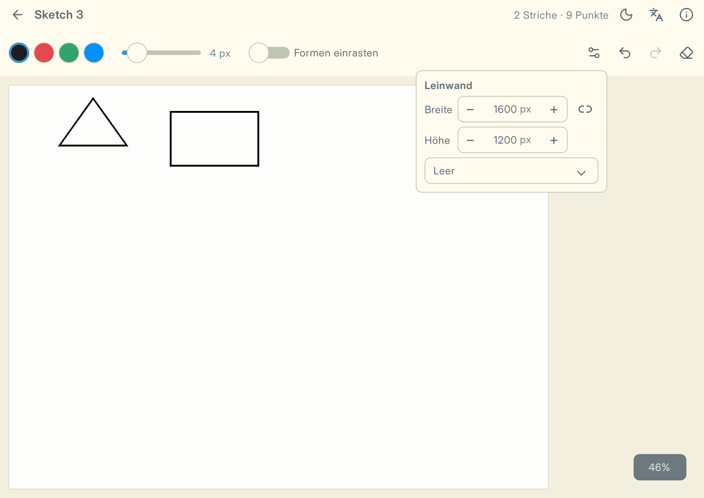

# Application essentials {#sec-essentials}

Applications earn trust by keeping data, language, and diagnostics predictable. These are small
features with outsized consequences.

## Text belongs to the user {#sec-i18n}

Put visible QML strings through `qsTr()` and C++ strings through `tr()` or
`QCoreApplication::translate()`. Translation files then hold language choices
outside the source, and the UI can switch language without creating a second code path.

Qt's translation tools extract source strings into `.ts` files; translators fill in the
translations and the build compiles them into resources. A language change needs the engine
to re-evaluate translated bindings, which the application controller connects to
`QQmlEngine::retranslate()`.

Use placeholders such as `%1` with `arg()` so a translator can change word order. For counts,
Qt's plural forms let each language provide the forms it needs. Sketchbook's list uses `%n`
for its stroke count. After adding strings, run the `update_translations` target and fill in
the `.ts` files before shipping.

{width=90%}

## Standard paths keep data findable {#sec-paths}

Use `QStandardPaths` for application data. It follows each platform's rules and keeps user
files out of an arbitrary working directory.

Set the application name and organization before using standard paths or `QSettings`: they
help Qt choose application-specific locations. Use `QSettings` for small preferences such as
a theme choice, and ordinary files for documents users create.

## Atomic saves keep the old file safe {#sec-save-file}

Write through `QSaveFile`: Qt commits the finished temporary file in place. A crash or full
disk leaves the previous file intact instead of leaving half a document.

::: {.snippet source="src/sketchbook/SketchStorage.cpp"}

```cpp
        QSaveFile file(path);
        if (file.write(json->data(), size) != size || !file.commit())\n            return failed(file.errorString());
```

:::

## Logs explain failures {#sec-logging}

Write structured logs to a user-accessible session file. Include build and system information
at startup. When a report arrives, that file gives support a place to start.

Logging categories identify the part of the app that wrote a message and let you filter output
without removing statements. Sketchbook keeps session logs and exposes their location through
the About dialog. Logs may contain personal data, so review their contents and retention before
asking a user to share them.

::: {.callout-note collapse="true"}
## Detail: crash diagnostics

A terminate handler can record an uncaught C++ exception and a stack trace in the log. The
operating system remains responsible for native crashes. Add automatic reporting only with a
clear privacy policy and a user choice.
:::

::: {.more}
**Template:** `src/app/LogSession.cpp` and `src/sketchbook/SketchStorage.cpp`

**Read more:** [QSaveFile](https://doc.qt.io/qt-6/qsavefile.html) and
[QStandardPaths](https://doc.qt.io/qt-6/qstandardpaths.html).
:::
