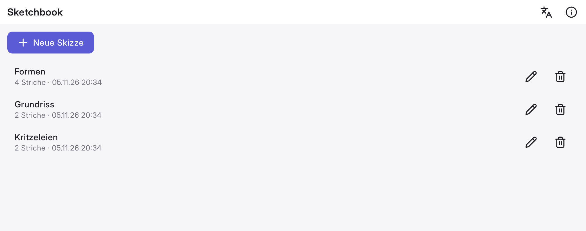
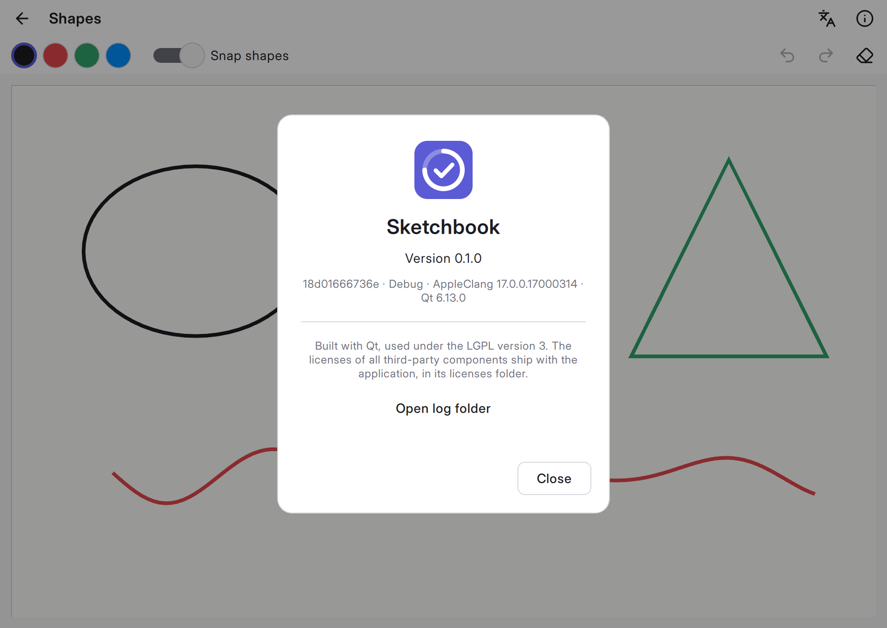

# What every real application needs {#sec-essentials}

A demo can skip these. A real application cannot: it speaks the user's language, keeps its
files in the right place, never loses data, and leaves a trail when something goes wrong.

## Translations {#sec-i18n}

Wrap every string the user sees: `qsTr()` in QML, `tr()` in C++. Let Qt handle plurals with
`%n`, and fill in values with `arg()` instead of joining strings, so translators can reorder
the sentence.

```qml
Label { text: qsTr("%n stroke(s)", "", strokeCount) }   // "1 stroke", "4 strokes"
Label { text: qsTr("Version %1").arg(Application.version) }
```

CMake extracts the strings into `.ts` files for translators and compiles them into the app:

```{.cmake filename="CMakeLists.txt"}
qt_standard_project_setup(REQUIRES 6.12
    I18N_SOURCE_LANGUAGE en
    I18N_TRANSLATED_LANGUAGES de
)
qt_add_translations(app TS_FILE_BASE app TS_FILE_DIR i18n)
```

Run the `update_translations` target to refresh the `.ts` files, translate them with Qt
Linguist, and rebuild.

{width=80%}

Switching the language while the app runs takes two steps: install a new `QTranslator`,
then call `QQmlEngine::retranslate()` so every `qsTr()` binding re-evaluates.

::: {.more}
**Template:** `AppController::setLanguage()` in `src/app/AppController.cpp`, and `i18n/` ·
**Read more:** [Internationalization with Qt](https://doc.qt.io/qt-6/internationalization.html)
:::

## Standard paths and settings {#sec-paths}

Never hardcode a path. Each platform has its own place for application data, configuration
and caches, and `QStandardPaths` knows them all:

```cpp
const auto dataDir =
    QStandardPaths::writableLocation(QStandardPaths::AppLocalDataLocation);
// macOS:   ~/Library/Application Support/<app>
// Windows: C:/Users/<user>/AppData/Local/<app>
// Linux:   ~/.local/share/<app>
```

The application and organization names you set on `QGuiApplication` become part of these
paths, so set them first thing in `main()`.

Small preferences, such as the last language or the window size, go into `QSettings`. It
stores them in the platform's native place:

```cpp
QSettings settings;
settings.setValue("language", "de");
const auto language = settings.value("language", "en").toString();
```

::: {.more}
**Template:** `src/app/main.cpp` (the template does not persist preferences yet) ·
**Read more:** [QStandardPaths](https://doc.qt.io/qt-6/qstandardpaths.html),
[QSettings](https://doc.qt.io/qt-6/qsettings.html)
:::

## Saving without losing data {#sec-save-file}

A crash or a full disk in the middle of a write leaves a half-written file, and the user's
work is gone. Write to a temporary file instead, and replace the old file only when the new
one is complete. `QSaveFile` does exactly that:

```cpp
QSaveFile file(path);
if (!file.open(QIODevice::WriteOnly) || file.write(json) < 0 || !file.commit())  // <1>
    qCWarning(lcStorage) << "Cannot save" << path << file.errorString();
```
1. Until `commit()` succeeds, the old file stays untouched.

Save on a worker thread (@sec-threads) so large files never freeze the UI.

::: {.more}
**Template:** `src/sketchbook/SketchStorage.cpp` ·
**Read more:** [QSaveFile](https://doc.qt.io/qt-6/qsavefile.html)
:::

## Logging {#sec-logging}

Log through a **category** per module. You can then switch the debug output of one module on
at run time, without rebuilding:

```{.cpp filename="SketchStorage.cpp"}
Q_STATIC_LOGGING_CATEGORY(lcStorage, "app.storage")

qCDebug(lcStorage) << "Saving" << path;
qCWarning(lcStorage) << "Cannot save" << path << file.errorString();
```

```sh
QT_LOGGING_RULES="app.storage.debug=true" ./Sketchbook
```

Write the log to a file as well, with a message handler (`qInstallMessageHandler`). Start
every log with the version, the commit, the compiler and the operating system: a log file
from a user is then enough to reproduce their setup.

{width=70%}

::: {.more}
**Template:** `src/app/Logging.cpp` ·
**Read more:** [QLoggingCategory](https://doc.qt.io/qt-6/qloggingcategory.html)
:::

## Crash diagnostics {#sec-crashes}

When an exception escapes, C++ calls `std::terminate()`, and by default the app simply
disappears. Install a handler that logs a stack trace first:

```{.cpp filename="Logging.cpp"}
std::set_terminate([] {
    qCCritical(lcCrash).noquote()
        << "Uncaught exception\n"
        << QString::fromStdString(cpptrace::generate_trace().to_string());
    std::abort();
});
```

A stack trace is only readable if the binary still knows its function names. Build releases
as `RelWithDebInfo` (optimized, with debug information), and keep the symbols when you deploy.

Crashes such as segmentation faults are different: code that runs after memory corruption
can do further damage. Leave them to the operating system's crash reporter, or to a crash
reporting service.

::: {.more}
**Template:** `src/app/Logging.cpp` ·
**Read more:** [cpptrace](https://github.com/jeremy-rifkin/cpptrace)
:::
