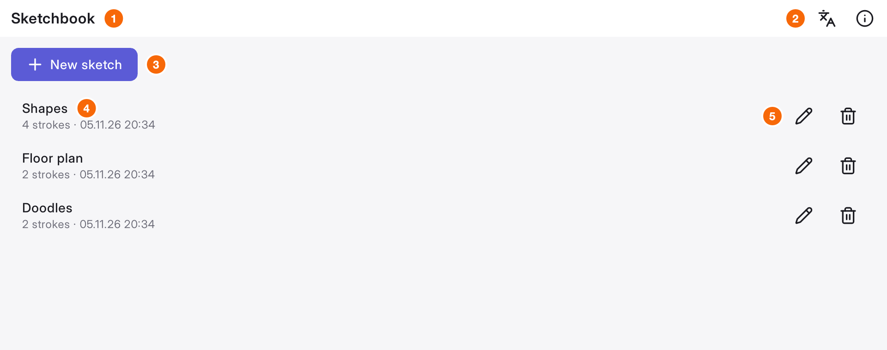
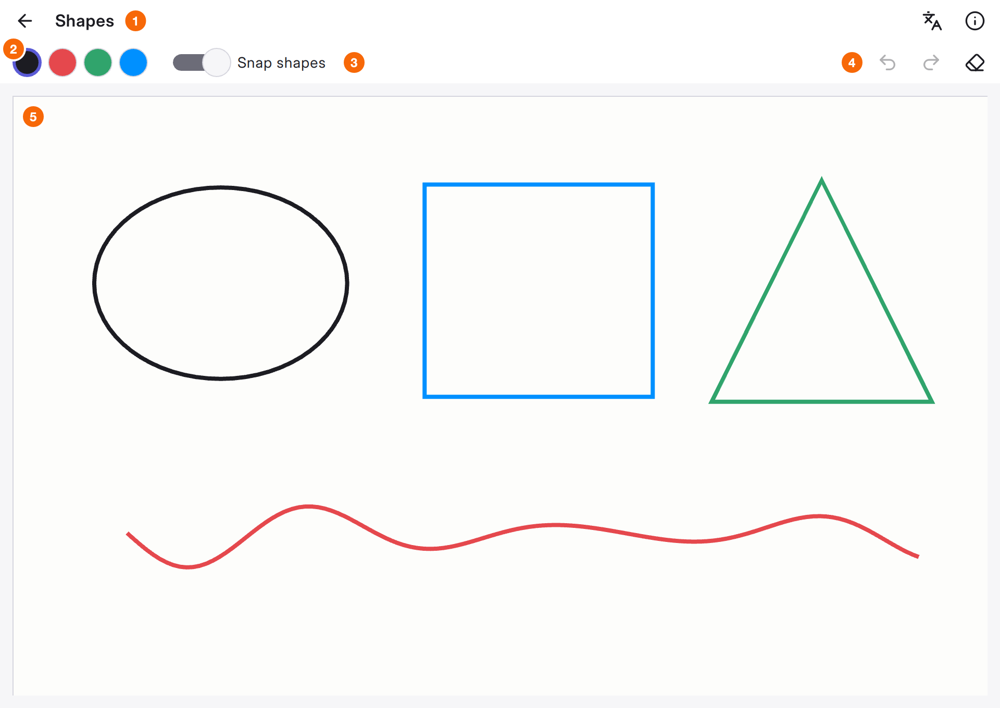

# Welcome {.unnumbered}

This guide teaches the concepts behind a modern Qt Quick application: how to structure it,
build it, connect C++ to QML, test it and ship it. It does not repeat the Qt reference
documentation. Each section explains one idea, shows it in a few lines of code, and points
to the place where you can read more.

Everything here is real. The guide comes with a template, a small but complete application
that applies every concept. When a section says **Template**, open that file and see the
idea at work.

## The app

The template's demo app is *Sketchbook*. You keep a list of sketches and draw on a canvas;
circles, rectangles and triangles you draw snap into clean shapes.

{#fig-tour-sketchbook}

1. **Window header.** Shows the app name here, and the sketch's name on the canvas.
2. **Language and About.** Switch between English and German while the app runs
   (@sec-essentials). *About* shows the version, the exact build, and where the licenses are.
3. **New sketch.** A button from the app's own control style (@sec-look).
4. **A sketch.** Name, stroke count and date, delivered by a C++ list model (@sec-cpp-qml).
5. **Rename and delete.** Commands that the view sends to its view model (@sec-patterns).

{#fig-tour-canvas}

1. **Back and title.** Returns to the sketchbook.
2. **Inks.** Four pen colors.
3. **Snap shapes.** A plain C++ library recognizes what you drew (@sec-layout).
4. **Undo, redo, clear.** Every edit can be undone, thanks to the Flux pattern (@sec-patterns).
5. **Paper.** A custom item that draws strokes with the scene graph (@sec-look). Scroll to
   move it, pinch or Ctrl+wheel to zoom.

## Quick start

You need Git, CMake 3.31 or newer, Ninja, a C++23 compiler and Qt 6.12 or newer.

```sh
git clone --recurse-submodules https://github.com/<you>/<your-app>.git
cd <your-app>
export QT_ROOT_DIR=~/Qt/6.12.0/macos
cmake --workflow --preset dev
```

The last command configures, builds and runs all tests. The first run takes a few minutes
because it builds the dependencies.

## How to read this guide

Read it front to back once. The chapters build on each other: first the shape of an
application, then the build, then Qt and QML, then quality and shipping. Afterwards, come
back to single sections when you need them.

Each section ends with a short line:

::: {.more}
**Template:** the file that shows the idea · **Read more:** one link that goes deeper
:::

The guide explains *why* and *what*. The linked documentation explains *every option*.

## What you should know already

You can write C++ and have seen a little QML. You do not need to know CMake or how Qt works
inside; that is what this guide is for.
